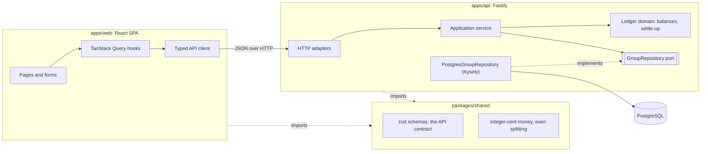

# Tally

[](https://github.com/mengxie/tally/actions/workflows/ci.yml)


[](LICENSE)

**Split shared costs with flatmates and friends, then settle up in as few payments as possible.**

Tally is a full-stack TypeScript app: a React frontend, a Fastify API and PostgreSQL, joined by a
single type-safe contract that both sides import. Create a group, share its link, log who paid
for what (split equally or by amount), and Tally keeps everyone's balance to the cent and tells
you exactly who should pay whom.

## Architecture



- **`packages/shared`** defines every request and response once, as zod schemas. The API validates
  requests with them; the web app validates its forms and every response with them. Change the
  contract and both apps fail to compile until they agree.
- **`apps/api`** is layered: HTTP adapters only parse, call one use case and present the result;
  the application service enforces rules that need data; the domain is pure arithmetic with no
  I/O. Persistence sits behind a port with two adapters, PostgreSQL and in-memory, and both pass
  the same contract test suite.
- **`apps/web`** keeps server state in TanStack Query (keyed caching, targeted invalidation after
  each change) and local state in components. Forms use React Hook Form with the shared rules.

In production the API also serves the built web app, so Tally deploys as **one container on one
origin**: no CORS, one health check, one thing to scale.

## Highlights

- **Money is integer cents end to end.** Typed amounts are parsed with string arithmetic, never
  floats. Leftover cents in an even split go to members in a fixed order, and the browser's live
  preview uses the very same function as the server, so they can never disagree.
- **Debt simplification you can explain.** Whoever owes the most pays whoever is owed the most,
  repeatedly: at most n − 1 payments, deterministic, and verified with property-based tests over
  thousands of random ledgers.
- **The database guards the rules too.** Composite foreign keys make "the payer belongs to this
  group" a database guarantee, not just an application check. Case-insensitive unique names,
  check constraints on amounts, and migrations that take a lock so several instances can start at once.
- **Production-grade API.** RFC 9457 problem details with stable error codes, security headers
  with a Content Security Policy, rate limiting, a readiness probe, graceful shutdown, structured
  logs, and configuration validated at startup so a bad deploy fails immediately.
- **Accessible, considered UI.** Labelled controls with linked error messages, live regions for
  status updates, colour never used alone to carry meaning, visible focus, dark mode, reduced
  motion respected, a self-hosted variable font, and route-level code splitting.

## Run it

With Docker, one command starts PostgreSQL and the app:

```bash
docker compose up --build
```

Open http://localhost:3000.

For development with hot reload (Node 22):

```bash
npm ci
docker compose up -d db                       # just the database
cp apps/api/.env.example apps/api/.env
npm run dev:api                               # API on http://localhost:3000
npm run dev:web                               # web on http://localhost:5173, proxying /api
```

| Script                  | What it does                                                      |
| ----------------------- | ----------------------------------------------------------------- |
| `npm run verify`        | Everything CI runs: format check, lint, typecheck, tests, build.  |
| `npm test`              | All test suites. Set `DATABASE_URL` to include PostgreSQL tests.  |
| `npm run test:coverage` | Tests with a coverage report.                                     |
| `npm run build`         | Production builds of the web app (Vite) and API (esbuild bundle). |
| `npm start`             | Runs the built app.                                               |

## Tests

| Package  | Tests | What they prove                                                                                                                                                                                                                                                   |
| -------- | ----- | ----------------------------------------------------------------------------------------------------------------------------------------------------------------------------------------------------------------------------------------------------------------- |
| `shared` | 27    | Money parses without float errors; splits always add up to the total (property-based); contract rules.                                                                                                                                                            |
| `api`    | 39    | Ledger maths (property-based), every use case, the HTTP layer (status codes, problem details, security headers, rate limiting, SPA fallback), and the repository contract against both adapters. The 5 PostgreSQL tests run when `DATABASE_URL` is set, as in CI. |
| `web`    | 10    | The real routes and data layer with only the network mocked (MSW): validation before sending, creating a group, settling up, deleting with confirmation, the split preview to the cent, server errors.                                                            |

CI also builds the Docker image, starts the full stack with `docker compose`, and checks that the
API is healthy and serves the web app.

## API

| Method & path                              | Purpose                                       |
| ------------------------------------------ | --------------------------------------------- |
| `POST /api/groups`                         | Create a group with its members.              |
| `GET /api/groups/:groupId`                 | The group and its members.                    |
| `POST /api/groups/:groupId/members`        | Add a person.                                 |
| `GET, POST /api/groups/:groupId/expenses`  | List (newest first) or add an expense.        |
| `DELETE /api/groups/:groupId/expenses/:id` | Remove an expense.                            |
| `GET, POST /api/groups/:groupId/payments`  | List or record a payment between two people.  |
| `GET /api/groups/:groupId/summary`         | Total spent, balances and suggested payments. |
| `GET /api/health`                          | Readiness, including the database.            |

Errors are `application/problem+json` with a stable `code` (for example `member.not_in_group`)
and, for validation failures, field-level `errors`.

## Project structure

```
packages/shared/   API contract (zod), money parsing and formatting, even splitting
apps/api/src/
  domain/          Pure ledger: balances and settle-up
  application/     Use cases, errors, and the GroupRepository port
  infrastructure/  Kysely database, migrations, PostgreSQL repository
  http/            Fastify app, routes, presenters, problem details
  main.ts          Composition root
apps/web/src/
  api/             Typed client and TanStack Query hooks
  app/             Routes, layout, query client
  features/        home/ and group/ screens
  components/      Receipt, wordmark, error states
docs/adr/          Architecture decision records
```

## Design decisions

1. [A monorepo with one shared contract package](docs/adr/0001-shared-contract.md)
2. [Integer cents and deterministic splitting](docs/adr/0002-integer-cents.md)
3. [Groups reached by link instead of accounts](docs/adr/0003-link-based-groups.md)
4. [A layered API with a repository port and a contract test suite](docs/adr/0004-layered-api.md)
5. [One deployable: the API serves the web app](docs/adr/0005-single-deployable.md)
6. [Greedy debt simplification](docs/adr/0006-greedy-settle-up.md)

## Limitations and next steps

- Anyone with a group's link can edit it, by design (see ADR 0003). Next: an optional edit PIN
  per group and an activity log showing who changed what.
- Expenses can be removed and re-added but not edited yet.
- Each group uses one currency.
- Browser end-to-end tests (Playwright) would complement the component tests.

## License

[MIT](LICENSE) © Meng Xie
